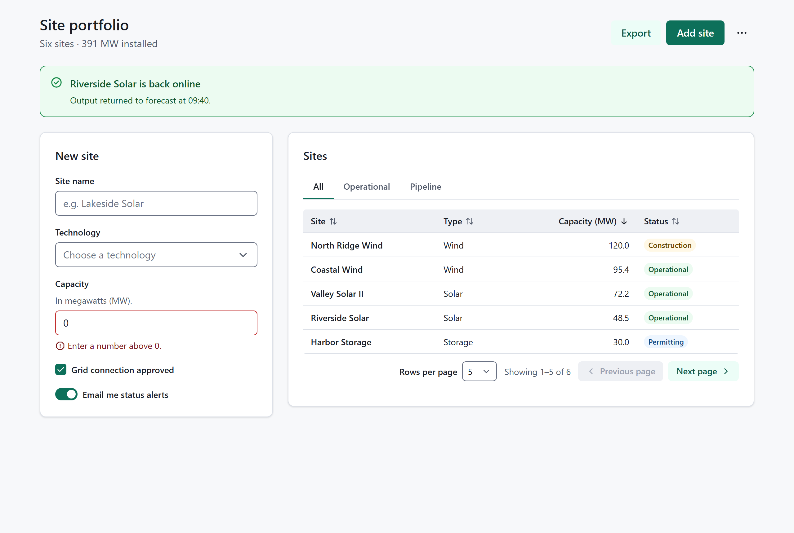
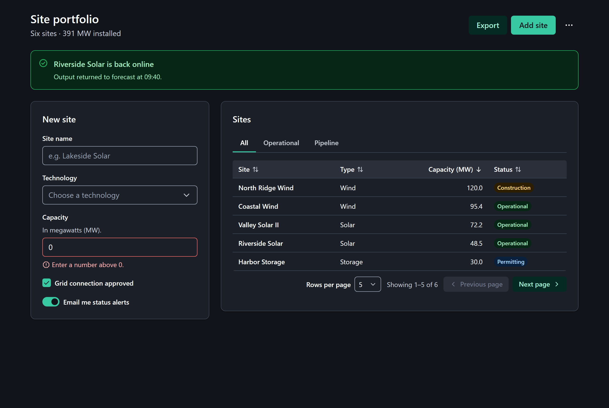
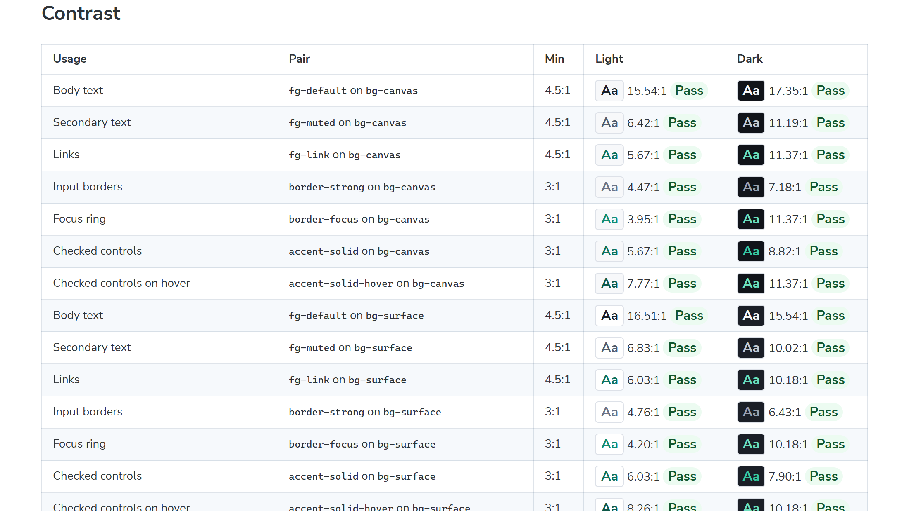
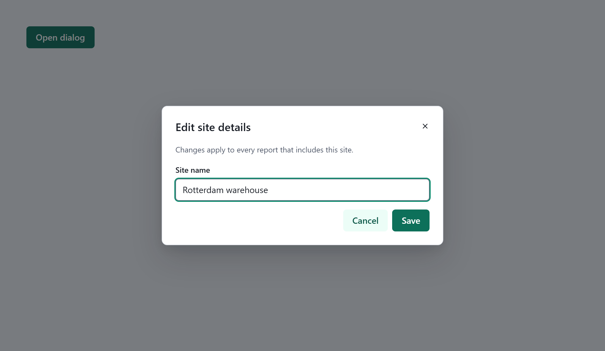
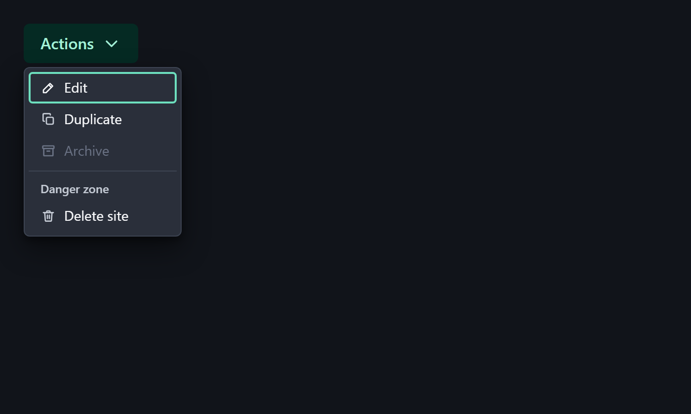
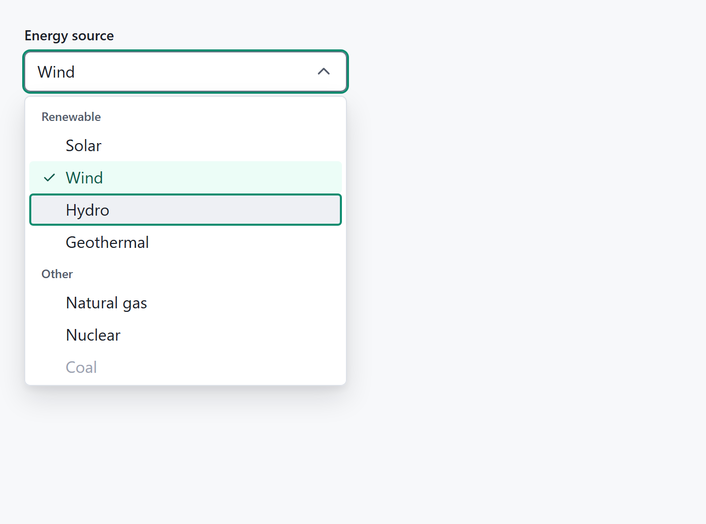
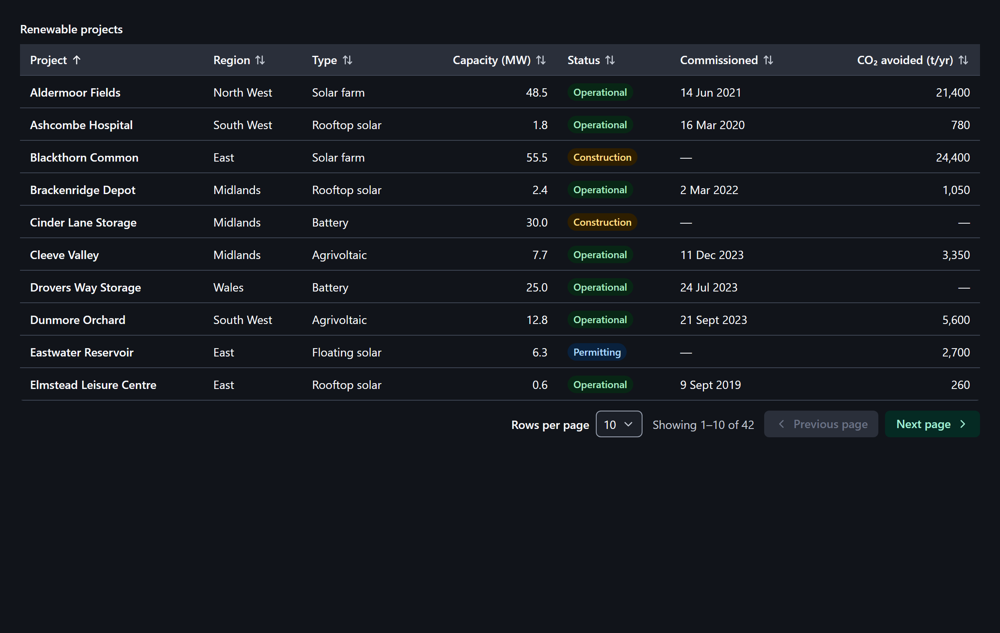

# Greenility UI

An accessible, themeable React component library in strict TypeScript, with design tokens, light and dark themes, and automated accessibility tests.

[](https://github.com/BrandonGreenDev/greenility-ui/actions/workflows/ci.yml)
[](LICENSE)

**[Live demo](https://greenility-ui.vercel.app)** · **[Storybook docs](https://greenility-ui.vercel.app/?path=/docs/introduction--docs)** · [Design decisions](DECISIONS.md) · [Changelog](CHANGELOG.md)

<table>
  <tr>
    <td width="50%"></td>
    <td width="50%"></td>
  </tr>
  <tr>
    <td align="center">Light theme</td>
    <td align="center">Dark theme</td>
  </tr>
</table>

## What it is

Greenility UI is a set of 21 React components, from Button and TextField to Dialog, Menu, a custom Select and a sortable DataTable. Each one is built on native HTML or a WAI-ARIA Authoring Practices pattern, styled only with design tokens, and documented in Storybook. It is a portfolio project, written from scratch without copying code from other libraries.

## Highlights

- **21 components** (30 exported React components, counting parts such as `Tab` and `MenuItem`), all with `forwardRef`, `className` merging and JSDoc on every prop.
- **Strict TypeScript 6** (`strict`, `noUncheckedIndexedAccess`) and ESLint with typescript-eslint strict type-checked plus jsx-a11y strict, with zero warnings allowed.
- **Zero runtime dependencies.** React and React DOM (18.2 or later) are peer dependencies. Helpers like `cx` are a few lines of local code.
- **Design tokens with light and dark themes.** One TypeScript source generates the CSS. Every foreground/background pair is contrast-tested in both themes in CI.
- **WAI-ARIA APG patterns** for every custom widget, and native elements wherever they are enough.
- **About 1,400 unit tests** (Vitest, Testing Library, user-event, axe in jsdom) and **axe on all ~275 stories** in light and dark, in Chromium, Firefox and WebKit.
- **Every component has a docs page** with usage, examples, a props table, accessibility notes and do/don't guidance.

## Components

<table>
  <thead>
    <tr><th>Group</th><th>Component</th><th>Built on</th></tr>
  </thead>
  <tbody>
    <tr><td rowspan="2">Actions</td><td>Button</td><td>Native <code>&lt;button&gt;</code></td></tr>
    <tr><td>IconButton</td><td>Native <code>&lt;button&gt;</code> with a required <code>aria-label</code></td></tr>
    <tr><td rowspan="7">Forms</td><td>TextField</td><td>Native <code>&lt;input&gt;</code></td></tr>
    <tr><td>TextArea</td><td>Native <code>&lt;textarea&gt;</code></td></tr>
    <tr><td>Checkbox</td><td>Native checkbox (including indeterminate)</td></tr>
    <tr><td>RadioGroup, Radio</td><td>Native radios in a <code>&lt;fieldset&gt;</code> with a <code>&lt;legend&gt;</code></td></tr>
    <tr><td>Switch</td><td>Native checkbox with <code>role="switch"</code> (<a href="https://www.w3.org/WAI/ARIA/apg/patterns/switch/">APG Switch</a>)</td></tr>
    <tr><td>NativeSelect</td><td>Native <code>&lt;select&gt;</code></td></tr>
    <tr><td>Select</td><td><a href="https://www.w3.org/WAI/ARIA/apg/patterns/combobox/examples/combobox-select-only/">APG select-only combobox</a></td></tr>
    <tr><td rowspan="4">Feedback</td><td>Alert</td><td>Static content, opt-in <code>status</code> or <code>alert</code> live region</td></tr>
    <tr><td>Badge</td><td>Static text</td></tr>
    <tr><td>Spinner</td><td><code>role="status"</code> with visually hidden text</td></tr>
    <tr><td>Toast (ToastProvider, useToast)</td><td>Polite live region, plus a named region reachable with F8</td></tr>
    <tr><td rowspan="4">Overlays</td><td>Dialog</td><td>Native <code>&lt;dialog&gt;</code> + <code>showModal()</code> (<a href="https://www.w3.org/WAI/ARIA/apg/patterns/dialog-modal/">APG Dialog (Modal)</a>)</td></tr>
    <tr><td>AlertDialog</td><td>Native <code>&lt;dialog&gt;</code> (<a href="https://www.w3.org/WAI/ARIA/apg/patterns/alertdialog/">APG Alert Dialog</a>)</td></tr>
    <tr><td>Tooltip</td><td><a href="https://www.w3.org/WAI/ARIA/apg/patterns/tooltip/">APG Tooltip</a>, <code>popover="manual"</code></td></tr>
    <tr><td>Menu</td><td><a href="https://www.w3.org/WAI/ARIA/apg/patterns/menu-button/">APG Menu Button</a>, <code>popover="manual"</code></td></tr>
    <tr><td rowspan="2">Navigation &amp; disclosure</td><td>Tabs</td><td><a href="https://www.w3.org/WAI/ARIA/apg/patterns/tabs/">APG Tabs</a> (automatic or manual activation)</td></tr>
    <tr><td>Accordion</td><td><a href="https://www.w3.org/WAI/ARIA/apg/patterns/accordion/">APG Accordion</a> (button in a heading)</td></tr>
    <tr><td rowspan="2">Data and utilities</td><td>DataTable</td><td>Native <code>&lt;table&gt;</code> with <code>aria-sort</code> (<a href="https://www.w3.org/WAI/ARIA/apg/patterns/table/examples/sortable-table/">APG Sortable Table</a>)</td></tr>
    <tr><td>VisuallyHidden</td><td>Text for assistive technology only</td></tr>
  </tbody>
</table>

## Accessibility approach

The target is WCAG 2.2 AA. How it is done:

- **Native first.** Buttons, inputs, radios, `<select>`, `<dialog>` and `<table>` are used wherever they fit. ARIA is added only where native HTML is not enough.
- **APG patterns** for custom widgets (Select, Menu, Tabs, Accordion, Tooltip), including their keyboard maps and typeahead.
- **Focus management.** Dialogs choose a sensible first focus target and return focus on close. Menus return focus to the trigger before running `onSelect`. Loading buttons and pagination bounds use `aria-disabled`, so focus never drops to `<body>`.
- **Announcement rules.** Field errors are linked with `aria-describedby` and are not live. Live regions are mounted first and then updated. Toasts and DataTable sort, page and loading changes go through one always-mounted polite region, one message per action.
- **Timing.** Warning, danger and action toasts stay until dismissed. Others pause on hover, focus and a hidden tab (WCAG 2.2.1).
- **User settings.** Motion durations come from tokens that collapse under `prefers-reduced-motion`. Components have `forced-colors` fixes so borders, focus rings and states stay visible. Checkbox, radio and switch targets are at least 24px tall, with no dead zone between the control and its label (WCAG 2.5.8).

How it is verified:

- **Contrast at the token level.** Unit tests compute the WCAG ratio of every foreground/background pair in both themes.
- **axe in jsdom** in the unit tests, at least once per meaningful state.
- **axe in real browsers.** CI builds Storybook and runs axe on every story in light and dark, in Chromium, Firefox and WebKit. This includes color contrast as rendered, which jsdom cannot check.

**Not yet verified:** no manual testing with NVDA, JAWS or VoiceOver has been done yet.

## Design tokens and theming

Tokens come in three layers:

1. **Palette**: raw hex colors (for example the "fern" brand scale). Components never use these.
2. **Semantic**: roles such as `--gn-color-fg-default` or `--gn-color-accent-solid`. Dark mode is a different mapping of these roles.
3. **Scales**: spacing, type, radius, shadow, motion, z-index and sizes.

All tokens are written in `src/tokens/tokens.ts`. `npm run tokens` generates `tokens.css`, and CI fails if the two drift apart. The same source feeds the Design Tokens docs page and the contrast tests.

Set `data-theme="light"` or `"dark"` on `<html>` or on any container. Themes can nest. `data-theme="system"` on `<html>` follows the operating system, and no provider is needed.



## Screenshots

<table>
  <tr>
    <td width="50%"></td>
    <td width="50%"></td>
  </tr>
  <tr>
    <td align="center">Dialog on native <code>&lt;dialog&gt;</code></td>
    <td align="center">Menu with groups and a disabled item (dark)</td>
  </tr>
  <tr>
    <td width="50%"></td>
    <td width="50%"></td>
  </tr>
  <tr>
    <td align="center">Custom Select with option groups</td>
    <td align="center">Sortable, paginated DataTable (dark)</td>
  </tr>
</table>

## Tech stack

- React 19 (peer range `>=18.2.0`), TypeScript 6
- Vite 8 in library mode (ESM, `preserveModules`) with vite-plugin-dts 5
- CSS Modules and CSS custom properties. No UI framework, no CSS-in-JS.
- Storybook 10 (`@storybook/react-vite`, addon-docs, addon-a11y)
- Vitest 5, jsdom 29, Testing Library, user-event, vitest-axe, axe-core 4
- Playwright 1.65 for the cross-browser story audit and screenshots
- ESLint 9 (typescript-eslint 8, jsx-a11y, react, react-hooks, storybook) and Prettier 3
- GitHub Actions CI, Vercel for the docs site
- Node 22 or later

## Key decisions

All decisions, with reasons, are in [DECISIONS.md](DECISIONS.md). Some of the more interesting ones:

- **Native `<dialog>` with `showModal()`** instead of a JS focus trap: the inert background, top layer, backdrop and Escape come from the platform.
- **No portals.** Overlays render in place and reach the top layer through `<dialog>` and `popover="manual"`, so they inherit `data-theme` and avoid z-index fights. The one exception: toasts move into the open modal, because `showModal()` makes everything outside it inert.
- **Two selects.** `NativeSelect` keeps the mobile picker, autofill and native validation. `Select` is a custom select-only combobox for when styled options and groups matter.
- **Tooltips are not dismiss layers.** Escape hides the tooltip without consuming the key, so one press also closes the menu or dialog around it.
- **Toast timing follows WCAG 2.2.1.** Warning, danger and action toasts persist. Others get reading time (60 ms per character) and pause on hover, focus and a hidden tab.
- **DataTable announces once per action** through one always-mounted polite region. Messages that arrive while loading are combined with the result, so "Loading" never overwrites them.
- **Errors use `aria-describedby`, not `aria-errormessage`**, because VoiceOver still does not announce `aria-errormessage`.
- **Tokens are authored in TypeScript** and generated to CSS, so one typed source feeds the styles, the docs and the contrast tests.
- **Zero runtime dependencies.** `cx` and `composeRefs` are about five lines each, so there is nothing to audit or update.
- **`forwardRef` is kept** although React 19 accepts `ref` as a prop, so the same build works on React 18 and 19.

## Getting started

The package is not published to npm yet. To try it in another project, build it and install the folder:

```bash
git clone https://github.com/BrandonGreenDev/greenility-ui.git
cd greenility-ui
npm install
npm run build
# then, in your app:
npm install ../greenility-ui
```

Import the stylesheet once at the root of your app. Wrap the app in `ToastProvider` if you use toasts:

```tsx
import 'greenility-ui/styles.css';
import { Button, ToastProvider, useToast } from 'greenility-ui';

function SaveButton() {
  const toast = useToast();
  return (
    <Button
      variant="primary"
      onClick={() => toast.show({ tone: 'success', title: 'Changes saved' })}
    >
      Save changes
    </Button>
  );
}

export function App() {
  return (
    <ToastProvider>
      <SaveButton />
    </ToastProvider>
  );
}
```

Pick a theme with `data-theme` on `<html>` or on any container:

```html
<html data-theme="system">
  <!-- "light", "dark", or "system" (follows the OS) -->
</html>
```

## Development

Requires Node 22 or later.

```bash
npm install
npm run storybook        # Storybook dev server on http://localhost:6006
npm test                 # all unit tests once
npm run lint             # ESLint, zero warnings allowed
npm run typecheck        # tsc --noEmit
npm run build            # library build to dist/
npm run build-storybook  # static Storybook in storybook-static/
npm run test:a11y        # axe on every built story, light and dark (run build-storybook first)
npm run tokens           # regenerate src/tokens/tokens.css from tokens.ts
npm run ci               # everything CI runs, in order
```

On Windows, `test`, `build` and `storybook` run through `scripts/run.ts`, which starts each tool from the real folder path, because a lower-case drive letter made Vitest load twice and made vite-plugin-dts skip declaration files.

## Project structure

```
.claude/agents/      agent definitions used to build the project
.github/workflows/   ci.yml
.storybook/          Storybook config, theme toolbar, branding
docs/                specs and README screenshots
scripts/             token build, cross-browser axe run, run.ts, screenshots
src/
  components/<Name>/ component, CSS Module, stories, tests, MDX docs
  hooks/             shared hooks (useControllableState, ...)
  utils/             shared helpers (cx, composeRefs, ...)
  tokens/            tokens.ts (source), tokens.css (generated), contrast tests
  docs/              Introduction, Design Tokens and Showcase pages
  index.ts           public API (named exports only)
```

## How it was built

The project was planned, built, tested and reviewed by a team of Claude Code subagents working under the author's direction: a planner, a component builder, a test writer, an accessibility reviewer, a code reviewer and a docs writer. Each component went through the same loop of spec, build, tests, two parallel reviews and fixes before it was committed. The agent definitions are in [`.claude/agents/`](.claude/agents/), and the workflow and definition of done are in [CLAUDE.md](CLAUDE.md). The author set the goals and made the checkpoint decisions.

## License

[MIT](LICENSE) © 2026 Brandon Green
